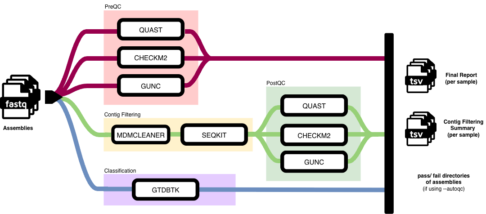

# QC MAGs

[](https://www.nextflow.io/)
[](https://www.docker.com/)
[](https://sylabs.io/docs/)

QC MAGs is a nextflow pipeline that assesses the quality of Metagenome Assembled Genomes (MAGs).

[[_TOC_]]



## Pipeline summary

The pipeline runs a number of QC tools to classify the bins and predict contamination levels for binned MAGs (fasta format).

In its simplest usage, **QC MAGs** takes a manifest (CSV; see [Generating a manifest](#generating-a-manifest)), and paths to databases for several tools as input. It then runs the following steps on the MAG bins (`fasta` files) within per-sample directories provided in the manifest:

1. **gtdbtk classify_wf**: Assemblies are classified taxonomically using steps detailed in the [gtdbtk docs](https://ecogenomics.github.io/GTDBTk/commands/classify_wf.html). The `ani_screen` step is skipped.
2. **QUAST, CheckM2 and GUNC**: [QUAST](https://github.com/ablab/quast) evaluates genome/metagenome assemblies by computing various metrics. [CheckM2](https://github.com/chklovski/CheckM2) is used to predict the completeness and contamination of genomic bins (independent of their taxonomic classification). [GUNC](https://github.com/grp-bork/gunc) is also run to check for chimerism and contamination. This stage is the 'preqc'.
3. **MDMCleaner and seqkit**: [MDMCleaner](https://github.com/KIT-IBG-5/mdmcleaner) is used to remove contaminant contigs and provide reliable contig classification of metagenome assembled genomes (MAGs). Sequences that are less than a minimum length (see parameter `min_contig`) are also removed from the resulting filtered/decontaminated fastas using [seqkit](https://bioinf.shenwei.me/seqkit/).
4. **QUAST, CheckM2 and GUNC**: The same commands as in stage 2 are run on the filtered fasta outputs (postqc).
5. **Reporting** A summary CSV report is created that combines the summary files of QUAST, CheckM2 and GUNC runs both before and after decontamination with MDMCleaner and GTDBTk classification.

Note: GTDBTk classification takes place once 'preqc', i.e. prior to contig filtering for length and contamination.

## Getting started

For example pipeline input, please see [Generating a manifest](#generating-a-manifest).

### On the Sanger HPC

To run the pipeline on the Sanger HPC as a module replace `nextflow run main.nf` with the name of the tool. For instance, to see a help message:

```
module load qc_mags
qc_mags --help
```

### From source

To run the pipeline from source (this repository):

1.  Clone the repository.
2.  Run with `docker`, use the path to the `-profile docker` option:

    ```
    nextflow run main.nf \
        -profile docker \
        --manifest test_data/manifest.csv \
        --gtdbtk_db /absolute/path/to/gtdbtk_db
        --checkm2_db path/to/checkm2_db \
        --gunc_db path/to/gunc_db \
        --mdmcleaner_db path/to/mdmcleaner_db
    ```

    :warning: The path provided to `--gtdbtk_db` must be an **absolute** filepath.

    Other profiles are also supported (`docker`, `singularity`).  
    :warning: If no profile is specified the pipeline will run with a Sanger HPC-specific configuration.

    See [usage](#usage) for all available pipeline options.

## Generating a manifest

The CSV manifest provided via the `--manifest` option should have the following format:

| ID       | mags_dir                                                                          |
| -------- | --------------------------------------------------------------------------------- |
| Sample_1 | Directory containing binned MAG assemblies generated from sample_1 (fasta format) |
| Sample_2 | Directory containing binned MAG assemblies generated from sample_2 (fasta format) |
| Sample_3 | Directory containing binned MAG assemblies generated from sample_3 (fasta format) |

The `--recursive` flag can be used in conjunction with the manifest to search each listed directory, automatically discovering all MAGs beneath the specified root paths rather than only those at the top level. Duplicate MAGs resolved to the same path across multiple entries are deduplicated prior to processing. When using this option, specifying `--batch_size` is required to ensure MAG counts per batch remain within sensible bounds — see [Batching large runs](#batching-large-runs).

## Configuration

### Report configuration

A configuration file can be supplied to the `--report_config` option to customise the final (per-sample) report generated by the pipeline. In particular, it allows (per-tool) customization of the identity column (to join the tool report tables together) and extract particular columns from these reports. The following tool names are currently mandatory: `QUAST`, `GTDBTK`, `GUNC`, `CHECKM2` (NOTE: tool name must be uppercase). In the following example config block, we select 2 columns (`classification` and `closest_genome_reference`) to extract from the GTDB-Tk report and to use `user_genome` as the identity column:

```
"GTDBTK": {
    "id_column": "user_genome",
    "keep_columns": [
        "classification",
        "closest_genome_reference"
    ]
}
```

Please refer to the default [`report_config.json`](./assorted-sub-workflows/qc_mags/assets/report_config.json) for expected JSON structure.

NOTE: In addition to columns derived from the tool reports, the script includes 4 columns `preqc_genome_name`, `postqc_genome_name`, `sample_or_strain_name` and `genome_status`. These are currently all derived from filenames (at some point).

| column                | description                                                                              |
| --------------------- | ---------------------------------------------------------------------------------------- |
| preqc_genome_name     | Name of the input fasta file minus extension                                             |
| postqc_genome_name    | Name of the fasta file output after contig filtering minus extension                     |
| sample_or_strain_name | Name of the fasta file up to the last `_` character                                      |
| genome_status         | `mag` if the fasta file contains the string `mag` (lower/uppercase), `isolate` otherwise |

The default columns included in the final report are as follows:

_General_

- preqc_genome_name
- postqc_genome_name
- sample_or_strain_name
- genome_status

_CheckM2_

- checkm2_postqc_Completeness
- checkm2_postqc_Contamination
- checkm2_postqc_Genome_Size
- checkm2_preqc_Completeness
- checkm2_preqc_Contamination
- checkm2_preqc_Genome_Size

_GTDBTk_

- gtdbtk_classification
- gtdbtk_closest_genome_reference

_GUNC_

- gunc_postqc_n_contigs
- gunc_postqc_pass.GUNC
- gunc_preqc_n_contigs
- gunc_preqc_pass.GUNC

_QUAST_

- quast_preqc\_\# contigs
- quast_preqc_Largest contig
- quast_preqc_Total length
- quast_preqc_GC (%)
- quast_preqc_N50
- quast_preqc_N90
- quast_preqc_auN
- quast_preqc_L50
- quast_preqc_L90
- quast_preqc\_\# N's per 100 kbp
- quast_postqc\_\# contigs
- quast_postqc_Largest contig
- quast_postqc_Total length
- quast_postqc_GC (%)
- quast_postqc_N50
- quast_postqc_N90
- quast_postqc_auN
- quast_postqc_L50
- quast_postqc_L90
- quast_postqc\_\# N's per 100 kbp

A note on **number of contigs** metrics: QUAST "# contigs" reports all contigs (both in pre and post QC reports) whilst GUNC's "num_contigs" is defined as all contigs that contain a mapped gene.

Please see output reports for these individual tools to see which columns you can _add_ to your own configuration. Remove any by omitting them from your custom config.

If using `autoqc` ensure your report config includes the column you wish to filter on. See below for more information.

### AutoQC configuration

It is also possible to automatically filter MAGs based on QC metrics produced in the summary report described in [Report configuration](#report-configuration).

To apply this function, you must enable AutoQC by supplying a configuration file path to `--autoqc_config` (config as described [here](./assorted-sub-workflows/mixed_input/README.md#filter_metadatapy)) or by supplying the string "default" so that the default [autoqc_config.tsv](./assorted-sub-workflows/qc_mags/assets/autoqc_config.tsv) is used.

The default AutoQC config's pass criteria are:

- Over 90% Completeness
- Under 5% Contamination
- Passes GUNC contamination checks

It is possible to add filtering rules to the autoqc config for columns\* within the report config. If using a custom report config you can customise your AutoQC config: for the column using the tool name (lowercase) and keep_column from the report config seperated by an underscore i.e. &lt;tool&gt;\_&lt;keep_column&gt;. Note that for adding filters based on QUAST, CheckM2 or GUNC you must specify whether to use preqc or postqc reports i.e. &lt;tool&gt;\_&lt;qc_stage&gt;\_&lt;keep_column&gt;, as shown in the [Report configuration](#report-configuration) section.

\*NOTE: Unfortunately QUAST report columns are not currently columns you can AutoQC on. This is an area for future development and should be possible in future versions.

Please note - if you add the parameter `--autoqc_config` but do not supply either a valid config file path or "default" the pipeline will error on not being able to find a config file to use.

## Usage

### Parameters

```
 Input options
      --manifest
            default: "null",
            Input manifest CSV of sample IDs and paths to directories containing assemblies (FASTA format) - must have header line
 -----------------------------------------------------------------
 Database options
      These parameters set paths to various databases used by the qc_mags workflow

      --checkm2_db
            default: /data/pam/software/checkm2_db/uniref100.KO.1.dmnd
            Path to checkm2 diamond database file
      --gunc_db
            default: /data/pam/software/gunc/GTDB/gunc_db_gtdb95.dmnd
            Path to GUNC diamond database file
      --mdmcleaner_db
            default: /data/pam/software/mdmcleaner/v1
            Path to MDMCleaner database directory
      --gtdbtk_db
            default: /data/pam/software/GTDBTk/release226
            Absolute path to gtdbtk database directory
-----------------------------------------------------------------
 Other options
      --fasta_ext
            default: fa
            Rename fasta output files using the given extension
      --report_config
            default: ./assorted-sub-workflows/qc_mags/assets/report_config.json
            Configuration file (JSON) to customise summary report
      --autoqc_config
            default: null
            Optionally filter MAGs that pass QC thresholds specified in the config. When applying this option you must either provide the path to a config or with the string "default" use the provided config at ./assorted-sub-workflows/qc_mags/assets/autoqc_config.json
      --min_contig
            default: 1000
            Contigs below this length will be filtered out by seqkit
      --skip_raw_reports
            default: false
            Skip publishing raw reports from various QC tools, keeping only final summary reports
      --temp_file_storage
            default: `/tmp`
            Specify a directory where GTDB-Tk can store temporary files during processing. Options are '/tmp', '/dev/shm' or 'null' (write to memory)
      --temp_space
            default: `30GB`
            Request a specific amount of temporary working space to reserve for GTDB-Tk jobs when submitted on a HPC (only relevant in combination with `temp_file_storage` having a value other than `null`)
-----------------------------------------------------------------
 Logging options
      --monochrome_logs
            default: false
            Should logs appear in plain ASCII

-----------------------------------------------------------------
```

Derived from the [QC MAGs subworkflow documentation](./assorted-sub-workflows/qc_mags/README.md).

### Inputs

- (Metagenomic) assemblies in fasta format, grouped in folders per sample

### Outputs

- (Metagenomic) assemblies, each corresponding to a taxonomic unit, that have been decontaminated using MDMCleaner and filtered for contig length according to `min_contig`. If using `autoqc` these are sorted into `pass` and `fail` directories.
- Reports generated by CheckM2, GTDB-Tk, GUNC and QUAST (unless using `--skip_raw_reports`).
- Final report TSV per-sample (with customisable columns) combining individual reports from various pipeline tools.
- Summary TSV of contigs filtered out per sample per bin. Please note that the small contigs (below `min_contig`) are calculated first, the contigs MDMCleaner-failed contigs are only those removed despite their length being above `min_contig`.

### GTDB-Tk runtime

Runtime and memory are reduced for GTDB-Tk classficiation when setting the `--temp_file_storage` option to a value other than `null`, which enables GTDBTk to write intermediate files to a specified location on disk rather than using RAM. This can reduce peak RAM usage by up to 89% and can improve runtime by up to 10%, often allowing the job to run with a smaller memory request, meaning it can start faster on cluster schedulers. On the Sanger cluster this is best done utilising `/tmp` and is therefore the default; `/dev/shm` is another option but is not reservable with LSF and a less stable option. Adapt this option as necessary when running outside of the Sanger cluster.

If you want to configure reserved temporary storage to request with LSF (i.e. when using `--temp_file_storage /tmp`) you can do this by requesting an amount (in GB) with the option `--temp_space`. Typically you should request < 100 GB, and no more then 1000 GB, as larger requests may cause jobs to remain pending. Note that due to a known bug reported in the farm documentation, please request half the memory you require as LSF double-accounts /tmp use see [here](https://ssg-confluence.internal.sanger.ac.uk/spaces/FARM/pages/101361225/Useful+LSF+resources#UsefulLSFresources-Resources).

### Dependencies

All software dependencies are containerised. Databases must be made available for CheckM2, GUNC, MDMCleaner and GTDBTk, paths supplied by params if not using the defaults.

### Troubleshooting

If a process in the pipeline fails with a non-zero exit code that is not recognised as a signal that memory or runtime limits were reached, the process will not be re-run and will be ignored. To understand why it has been ignored, please check the process-specific log file `.command.log` in the work directory of the affected process.

On the Sanger farm (HPC), a post-run script is available to automatically show the end of these log files (where informative messages can often be found) and return affected sample identifiers. See [here](https://ssg-confluence.internal.sanger.ac.uk/spaces/PaMI/pages/181078206/General+pipeline+info#Generalpipelineinfo-Usingthepipelinetracefile) for more details.

### Batching large runs

Many of the tools within the pipeline benefit from processing multiple MAGs simultaneously. To enable cross-sample batching, specify a `batch_size` using the flag:

```bash
--batch_size <INT>
```

This flag aggregates MAGs across samples into batches of N, with any remainder assigned to a final batch. For example, to define batches of 2000:

```bash
--batch_size 2000
```

Batch size involves a trade-off between throughput and resource usage. Larger batches improve computational efficiency but increase run-time per job, while smaller batches can reduce latency — particularly on an uncontested cluster — but at the cost of significantly higher memory overhead. Note that batches below ~1000 MAGs may incur disproportionate database loading overhead relative to actual QC compute time. A batch size of 1000–2000 MAGs is recommended for most use cases to strike a balance.
